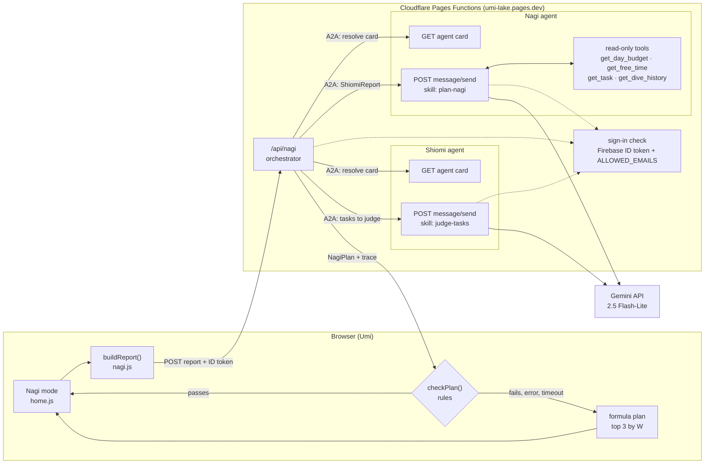
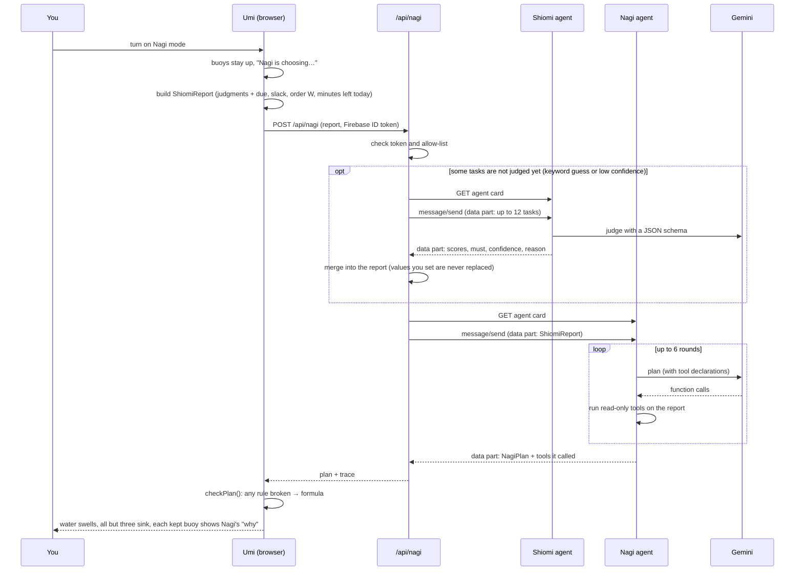

# Umi

A task dashboard where tasks float as buoys on a low-poly lake. Finish one and it sinks, piling up on the lakebed.

**Live demo: https://umi-lake.pages.dev** (sign in with Google to sync and to use the agents; signed out, everything stays in your browser)

The interface is in English by default; Japanese can be chosen in **Settings → Language** (or open the page with `?lang=ja`).
A few names are kept as they are in both languages: **Umi** (the app, "sea"), **Nagi** (the calm mode, "a dead-calm sea") and **Shiomi** (the AI that weighs tasks, "tide-watcher").

## How it works

- **Where a buoy floats**
  - **Front ↔ back = slack**: days until the due date minus the days of work. Anything within a day (late, half a day, today) sits on the front line; 3 more days of slack reach the middle; no due date floats at the back.
  - **Right ↔ left = weight**: light tasks stay near the shore on the right; heavy ones drift offshore to the left (we read from the left, so the heavy ones come first).
  - **Size = effort**: bigger buoys take longer.
- **Sink**: press a buoy and choose *Sink*, or long-press it (0.7 s). It drops through the water and piles up on the lakebed.
- **Drag**: grab a buoy and move it. Where you drop it becomes its values: toward the shore = lighter, offshore = heavier (I and P are set to match), toward the front = due sooner, toward the back = more slack (the due date is worked back from the depth; the far back means someday). These count as your own values, so Shiomi learns from them too. Undo from the toast.
- **Views**: scroll (or use the arrow keys) to move between the *Overview* from the sky, the surface, and the *Lakebed*.
- **Nagi mode**: the water swells once and settles, every buoy except the three to do now sinks out of sight, and the camera frames the three that remain.
- **Dive (focus timer)**: dive under one task's buoy (25 min, 50 min or no limit); depth follows the time. Stray thoughts become *bubble notes* that rise to the surface. When you surface, take a *decompression* break of one fifth of the dive, then float the bubble notes as tasks or drop them.
- **Sky and water**: the light follows the time of day (morning, day, evening, night with a moon). The weather follows how busy you are: every open task adds its weight × how close its deadline is (no slack left = strongest, a week away = weak, no due date ≈ 0), so more tasks, heavier tasks and closer deadlines all raise it → Nagi < Ripples < Waves < Rough < Storm. The header gauge shows the same five steps.
- **Alerts**: a small fin circles a risky must-do task and nudges it now and then.
- **Quick entry**: type `tomorrow 3pm stats homework #school 1h must heavy weekly` (or the Japanese 「明日15時 統計の課題 #大学 1時間 必須 重い 毎週」) and the date, time, area, estimate, type, weight and repeat are read from it.

## Weighting

Shiomi (Gemini, through `/api/weigh`) judges only four values per task, 1–10: **I** value, **P** cost of missing it, **E** effort, **D** others waiting, plus whether it is a **must**. Everything else is computed in the browser (`store.js`):

```
weight   V = (I^1.2 × aging + P^1.3) × D'        D' = 1 + (D − 1) / 9
urgency  U = (1 + 2 / (max(0, slack) + 0.5))^1.5
order    W = V / hours^0.6 × U                    (the card order, Nagi mode's three, the fin alerts)
```

Values you set by hand win over Shiomi, and Shiomi wins over a keyword estimate. Tasks whose weight you corrected are sent as examples, so Shiomi learns your yardstick. Its short reasons come back in the language you use.

## Data and sign-in

- Signed out, data stays in this browser (`localStorage`). The agents are off; Nagi mode uses the formula.
- Signed in with Google (Firebase Auth), data is one Firestore document per person (`umi/{uid}`) and syncs across devices.
- Every server endpoint checks the Firebase ID token and an allow-list (`ALLOWED_EMAILS`) before calling Gemini, so nobody else can spend the key.

## Agents: Shiomi and Nagi over A2A

Nagi mode is where the agents matter. Instead of only sorting by the formula, a **planner agent (Nagi)** picks the
three tasks to keep afloat and gives a one-line reason for each, using the judgments of a second agent (**Shiomi**).
The two are separate A2A agents, each with its own endpoint and agent card, and work is handed between them over A2A.

| | Shiomi (judge) | Nagi (planner) |
|---|---|---|
| Question | "How heavy is this task?" | "Which three now, and why?" |
| Endpoint | `/api/agents/shiomi` | `/api/agents/nagi` |
| Input | Task titles (up to 12) and the language | A **ShiomiReport**: today's and this week's open tasks with due dates, slack, the formula's order, and Shiomi's judgments |
| Output | Per task: impact, penalty, effort, dependency (1–10), must, confidence (0–1), a reason | A **NagiPlan**: up to three tasks to keep with a reason each, optional suggestions, one calm message |
| How | One Gemini call with a JSON schema | A Gemini function-calling loop (up to 6 rounds) with four read-only tools |
| Changes your data | No | No — it only proposes |

### Structure



### One planning run



A real run on the live site (2026-11-28, five made-up tasks, one of them only keyword-guessed) took about 4 seconds
end to end and returned this trace with the plan:

```json
{ "engine": "cloudflare-a2a", "shiomi": 1, "nagi": true,
  "tools": ["get_day_budget", "get_free_time"], "model": "gemini-2.5-flash-lite" }
```

Shiomi judged the one unclear task ("Prep"), Nagi checked the time left and the calendar (not connected), and kept the
assignment due tonight, the rent and the daily Spanish words. It also suggested a dive for a task it had *not* kept;
`checkPlan()` drops that kind of suggestion (see the guard rails below).

### How the A2A handoff works

- **Agent cards.** `GET /api/agents/shiomi` and `GET /api/agents/nagi` return an A2A agent card (protocol 0.3.0):
  name, description, endpoint URL, one skill (`judge-tasks` / `plan-nagi`), JSON in and out, and a bearer
  security scheme (the Firebase ID token). They are public: open
  [shiomi](https://umi-lake.pages.dev/api/agents/shiomi) or [nagi](https://umi-lake.pages.dev/api/agents/nagi) in a browser.
- **Messages.** The orchestrator (`/api/nagi`) first fetches the card, then sends a JSON-RPC 2.0 request with
  method `message/send`. The payload is a message with one **data part** (structured JSON, not prose).
  The agent answers with a message whose data part holds the result. A `contextId` ties the calls of one run together.
- **Real HTTP, same project.** Both agents live in the same Cloudflare Pages project as the app, but the
  orchestrator calls them over HTTP like any other A2A client would, so either agent can be called or tested on its own.
  The token travels with every call and each agent checks it again.
- **What crosses the boundary.** Shiomi sees only task titles and the language. Nagi sees the ShiomiReport
  (no notes, nothing from the lakebed).
- **What is not there.** Only `message/send` is implemented: no streaming, no push notifications, no long-running tasks.

### What each agent actually does

**Shiomi** (`functions/api/agents/shiomi.js`) scores each task 1–10 on impact, penalty, effort and dependency,
decides must or not ("real harm or no way back if skipped", not "someone is waiting"), and says how sure it is.
Gemini answers in a fixed JSON schema; the server clamps every number and drops unknown ids.
In a planning run it is asked only about tasks the report does not know well, and its answer is used for that plan only.
(A similar judgment also runs on its own whenever you add or rename a task, through `/api/weigh`. Those results are
saved on the task and shown on its card, so in practice most tasks reach Nagi already judged.)

**Nagi** (`functions/api/agents/nagi.js`) is given the rules of a plan in its instruction: values you set are fixed,
overdue must-dos always stay, prefer little slack, must, high penalty and someone waiting, fit the minutes left today,
lean on due dates when Shiomi is unsure, suggest little, and write one calm sentence. It decides which tools to call:

| Tool | Returns | Notes |
|---|---|---|
| `get_day_budget` | minutes per day, used today, left, planned for today | |
| `get_free_time` | free blocks today | **not connected yet**: always answers "calendar not connected" |
| `get_task(task_id)` | everything the report holds about one task | |
| `get_dive_history` | recent focus sessions per task | |

The tools only read the report sent with the request; none can read or change your stored data.

### Guard rails in the browser (`nagi.js`)

The plan is never applied as is. `checkPlan()` keeps only ids that are open tasks, at most three, no duplicates;
rejects the whole plan if an overdue task **you** marked must is missing; accepts only the suggestions
`tomorrow`, `lighter`, `later` (+3 days) and `dive` (25 or 50 min, kept tasks only); trims all text; and caps
`validUntil` at four hours. Suggestions run only when you tap them, through the same code as the normal buttons.

Nagi mode falls back to the formula (top three by W) when you are signed out, the agent is turned off in Settings,
the server answers with an error, there is no answer within 25 seconds, or the plan breaks a rule.
A formula plan is labelled "Nagi (formula)" on the cards, so you can tell which one you are looking at.
A plan is kept until its `validUntil` (about three hours) and asked for again at most every ten minutes.

### Not built yet

- Calendar access for `get_free_time` (read-only Google Calendar).
- Suggestions as A2UI-style cards, and a fixed evaluation set for prompt changes.
- The same two agents on Google's ADK for Cloud Run are kept in `docs/reference/adk-agents/` as a reference; they are not deployed.

Design notes and the full report and plan formats: `docs/nagi-agent-design.md`.

## Built with

three.js (Water, Sky), GSAP (Observer), SunCalc, chrono-node, SortableJS, tinykeys, Lenis. Firebase Auth and Firestore.
Gemini 2.5 Flash-Lite (Flash as a fallback). Hosted on Cloudflare Pages; the server side is Pages Functions.

The front end has no build step: the browser loads plain ES modules.

```
python -m http.server 8835       # front end only (the agents need Pages Functions)
npm run deploy                   # copy the site into dist/ and deploy to Cloudflare Pages (Wrangler)
```

Pages settings (never in the repo): `GEMINI_API_KEY` (secret), `ALLOWED_EMAILS`, and optionally `GEMINI_MODEL`.

| Path | What |
|---|---|
| `index.html`, `home.js`, `home-scene.js` | the lake home (three.js) |
| `store.js` | data, the weighting formula, placement |
| `nagi.js` | ShiomiReport, the formula plan, `checkPlan()`, the call to `/api/nagi` |
| `cloud.js` | sign-in, Firestore sync, Shiomi's `/api/weigh` calls |
| `functions/api/agents/` | the Shiomi and Nagi A2A agents |
| `functions/api/nagi.js`, `functions/api/weigh.js` | the orchestrator, and Shiomi's quick judgment |
| `functions/__/` | passes Firebase's sign-in pages through our own domain |
| `server/agents.js` | shared: sign-in check, Gemini, agent cards, the A2A server and client |
| `api/`, `vercel.json` | the earlier Vercel deployment (umi-ten.vercel.app), kept until it is retired |

Layout checks: `sh tools/align-check.sh` measures the shared layout lines at three widths.

## Docs

- `docs/dive-research.md` — prior work, ideas and scoring behind Dive
- `docs/improve-set1.md`, `docs/improve-set2.md` — two review rounds (30 issues found, 15 fixed each)
- `docs/ui-review/README.md` — the button and motion rules, with the 30 references they came from
- `docs/shore-references.md` — references behind the land/water cut-away
- `docs/nagi-agent-design.md` — the Nagi planning agent and its A2A handoff from Shiomi
- `docs/reference/adk-agents/` — the same two agents on Google's ADK for Cloud Run (reference, not deployed)
