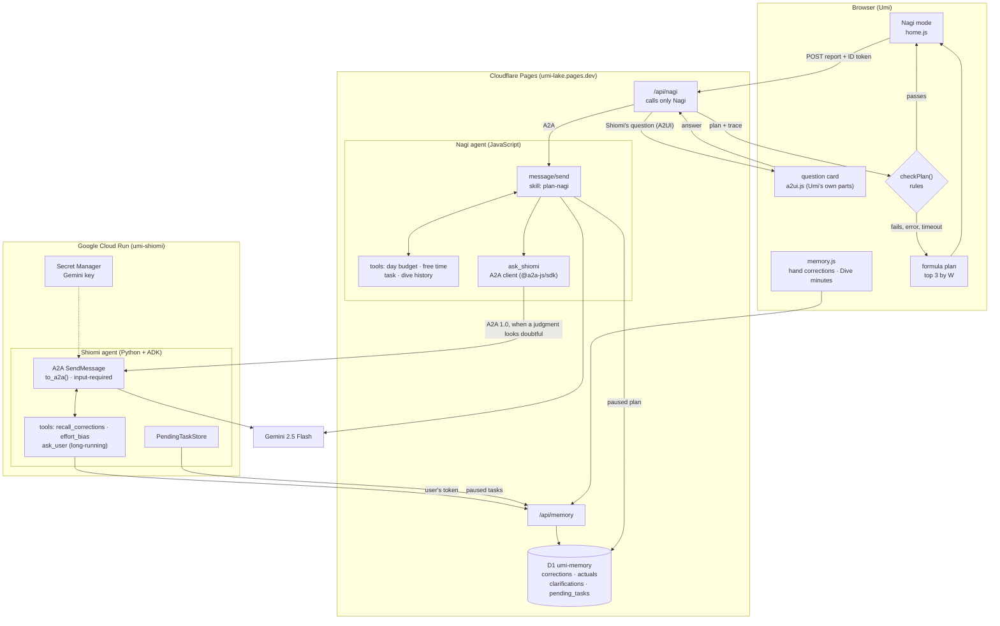
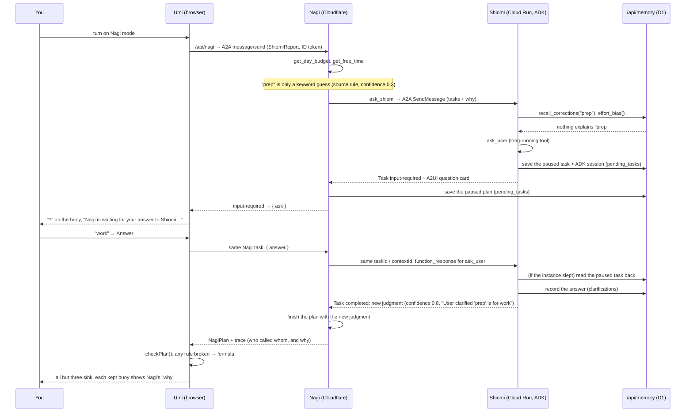

# Umi

A task dashboard where tasks float as buoys on a low-poly lake. Finish one and it sinks, piling up on the lakebed.

**Live demo: https://umi-lake.pages.dev** (sign in with Google to sync and to use the agents; signed out, everything stays in your browser)

The interface is in English by default; Japanese can be chosen in **Settings → Language** (or open the page with `?lang=ja`).
A few names are kept as they are in both languages: **Umi** (the app, "sea"), **Nagi** (the calm mode, "a dead-calm sea") and **Shiomi** (the AI that weighs tasks, "tide-watcher").

## How it works

- **Where a buoy floats**
  - **Front ↔ back = slack**: days until the due date minus the days of work. Anything within a day (late, half a day, today) sits on the front line; 3 more days of slack reach the middle; no due date floats at the back.
  - **Right ↔ left = weight**: light tasks stay near the shore on the right; heavy ones drift offshore to the left (we read from the left, so the heavy ones come first).
  - **Size = effort**: bigger buoys take longer.
- **Sink**: press a buoy and choose *Sink*, or long-press it (0.7 s). It drops through the water and piles up on the lakebed.
- **Drag**: grab a buoy and move it. Where you drop it becomes its values: toward the shore = lighter, offshore = heavier (I and P are set to match), toward the front = due sooner, toward the back = more slack (the due date is worked back from the depth; the far back means someday). These count as your own values, so Shiomi learns from them too. Undo from the toast.
- **Views**: scroll (or use the arrow keys) to move between the *Overview* from the sky, the surface, and the *Lakebed*.
- **Nagi mode**: the water swells once and settles, every buoy except the three to do now sinks out of sight, and the camera frames the three that remain.
- **Dive (focus timer)**: dive under one task's buoy (25 min, 50 min or no limit); depth follows the time. Stray thoughts become *bubble notes* that rise to the surface. When you surface, take a *decompression* break of one fifth of the dive, then float the bubble notes as tasks or drop them.
- **Sky and water**: the light follows the time of day (morning, day, evening, night with a moon). The weather follows how busy you are: every open task adds its weight × how close its deadline is (no slack left = strongest, a week away = weak, no due date ≈ 0), so more tasks, heavier tasks and closer deadlines all raise it → Nagi < Ripples < Waves < Rough < Storm. The header gauge shows the same five steps.
- **Alerts**: a small fin circles a risky must-do task and nudges it now and then.
- **Quick entry**: type `tomorrow 3pm stats homework #school 1h must heavy weekly` (or the Japanese 「明日15時 統計の課題 #大学 1時間 必須 重い 毎週」) and the date, time, area, estimate, type, weight and repeat are read from it.

## Weighting

Shiomi (Gemini, through `/api/weigh`) judges only four values per task, 1–10: **I** value, **P** cost of missing it, **E** effort, **D** others waiting, plus whether it is a **must**. Everything else is computed in the browser (`store.js`):

```
weight   V = (I^1.2 × aging + P^1.3) × D'        D' = 1 + (D − 1) / 9
urgency  U = (1 + 2 / (max(0, slack) + 0.5))^1.5
order    W = V / hours^0.6 × U                    (the card order, Nagi mode's three, the fin alerts)
```

Values you set by hand win over Shiomi, and Shiomi wins over a keyword estimate. Tasks whose weight you corrected are sent as examples, so Shiomi learns your yardstick. Its short reasons come back in the language you use.

## Data and sign-in

- Signed out, data stays in this browser (`localStorage`). The agents are off; Nagi mode uses the formula.
- Signed in with Google (Firebase Auth), data is one Firestore document per person (`umi/{uid}`) and syncs across devices.
- Every server endpoint checks the Firebase ID token and an allow-list (`ALLOWED_EMAILS`) before calling Gemini, so nobody else can spend the key.

## Agents: Shiomi and Nagi over A2A

Nagi mode is where the agents matter. A **planner agent (Nagi)** picks the three tasks to keep afloat and gives a
one-line reason for each. When a judgment looks doubtful, Nagi decides by itself to consult a second agent, the
**judge (Shiomi)**. Shiomi has a memory of how you corrected it and how long things really took, and when a title is
too vague it **asks you back** instead of guessing. The two agents are written in different languages and run on
different clouds; they are connected only by A2A.

| | Shiomi (judge) | Nagi (planner) |
|---|---|---|
| Question | "How heavy is this task?" | "Which three now, and why?" |
| Runs on | Google Cloud Run, Python + **Google ADK** (`agents/shiomi/`) | Cloudflare Pages Functions, JavaScript (`functions/api/agents/nagi.js`) |
| Agent card | [`/.well-known/agent-card.json`](https://umi-shiomi-1048912442846.europe-west1.run.app/.well-known/agent-card.json) (A2A 1.0) | [`/api/agents/nagi`](https://umi-lake.pages.dev/api/agents/nagi) (A2A 0.3) |
| Tools | `recall_corrections(title)`, `effort_bias()` (memory, read through `/api/memory`), `ask_user(...)` (long-running: pauses the task) | `get_day_budget`, `get_free_time`, `get_task`, `get_dive_history`, **`ask_shiomi(task_ids, why)`** |
| Output | Per task: impact, penalty, effort, dependency (1–10), must, confidence, a reason, and what from memory changed it | A **NagiPlan**: up to three tasks with a reason each, optional suggestions, one calm message, and a trace |
| Model | gemini-2.5-flash (key in Secret Manager) | gemini-2.5-flash |
| Changes your data | Only its memory rows (answers you gave it) | No — it only proposes |

### Structure



### One planning run, with a question



Measured on the live site on 2026-11-28 (made-up tasks): a plan where Nagi consulted Shiomi took 15.8 s
(Shiomi 7.6 s of it); a run where Shiomi asked back paused after 9.5 s, and the answer led to a plan 12.5 s later
(Shiomi 5.3 s). The traces are in `docs/story-facts.md`.

### How the A2A connection works

- **Two kinds of A2A server.** Shiomi is served by ADK's `to_a2a()` (a2a-sdk 1.3, protocol 1.0, with 0.3 compatibility).
  Nagi's server is a small JSON-RPC `message/send` handler on Cloudflare that returns A2A Tasks
  (`completed`, or `input-required` while it waits).
- **The client.** Nagi's `ask_shiomi` reads Shiomi's agent card with the official A2A JS SDK (`@a2a-js/sdk`) and
  sends the doubtful tasks as a message; the reply is a Task.
- **Asking back.** Shiomi's `ask_user` is an ADK `LongRunningFunctionTool`. ADK turns the paused call into task state
  `input-required`; Shiomi adds the question as A2UI v0.9 messages (data parts, mimeType `application/json+a2ui`,
  basic catalog). The card says so in two extensions: A2UI, and Umi's ask-back note. The browser draws only a fixed set of
  components with its own parts (`a2ui.js`); the agent never writes HTML.
- **Resuming.** The answer goes back as a `function_response` data part with the same taskId and contextId.
  Cloud Run scales to zero, so a paused task and its ADK session are saved to D1 (`pending_tasks`) and read back on
  any instance. Nagi's own paused plan is saved the same way.
- **Sign-in.** Every call carries your Firebase ID token. Nagi, `/api/memory` and Shiomi each check it against the
  allow-list. Shiomi forwards it to `/api/memory`, which takes the uid from the token, so each person's memory is
  separate and no extra secret is needed.
- **Limits.** At most 2 consultations of up to 4 tasks per plan, and at most one question to you per plan.

### Shiomi's memory (`/api/memory`, Cloudflare D1)

| Table | Written when | Used by |
|---|---|---|
| `corrections` | you change a weight by hand (card buttons, dragging a buoy, "lighter") | `recall_corrections`: similar titles (shared words) and what you changed |
| `actuals` | a Dive ends | `effort_bias`: real minutes against the estimate, per task |
| `clarifications` | you answer Shiomi's question | `recall_corrections`: so it does not ask the same thing twice |
| `pending_tasks` | a task is waiting for your answer | Shiomi's task store and Nagi's paused plan |

Similar tasks are found by shared words in the title (Japanese by character pairs). Embedding search is not built.

### Guard rails in the browser (`nagi.js`)

The plan is never applied as is. `checkPlan()` keeps only ids that are open tasks, at most three, no duplicates;
rejects the whole plan if an overdue task **you** marked must is missing; accepts only the suggestions
`tomorrow`, `lighter`, `later` (+3 days) and `dive` (25 or 50 min, kept tasks only); trims all text; and caps
`validUntil` at four hours. Suggestions run only when you tap them, through the same code as the normal buttons.

Nagi mode falls back to the formula (top three by W) when you are signed out, the agent is turned off in Settings,
the server answers with an error, there is no answer within 75 seconds, or the plan breaks a rule.
A formula plan is labelled "Nagi (formula)" on the cards. While Shiomi's question is open, nothing sinks.
If you press "Let Shiomi guess", Shiomi judges with a low confidence and nothing is recorded.

### Not built yet

- Calendar access for `get_free_time` (read-only Google Calendar).
- Embedding search for similar tasks (Vectorize + Workers AI).
- Using Shiomi from other apps over A2A (e.g. Life Dashboard).
- The quick judgment when you add or rename a task (`/api/weigh`) is still one Gemini call on Cloudflare, not Shiomi.

Design notes and the full report and plan formats: `docs/nagi-agent-design.md`.


## Built with

three.js (Water, Sky), GSAP (Observer), SunCalc, chrono-node, SortableJS, tinykeys, Lenis. Firebase Auth and Firestore.
Gemini 2.5 Flash and Flash-Lite. Google ADK + a2a-sdk (Python) for Shiomi on Cloud Run; the official A2A JS SDK for Nagi's client.
The app and Nagi are hosted on Cloudflare Pages (Pages Functions, D1 for Shiomi's memory).

The front end has no build step: the browser loads plain ES modules.

```
python -m http.server 8835       # front end only (the agents need Pages Functions)
npm run deploy                   # copy the site into dist/ and deploy to Cloudflare Pages (Wrangler)
cd agents/shiomi && python tests/test_flow.py    # Shiomi's ask → pause → resume flow, offline
```

Shiomi is deployed with `gcloud run deploy umi-shiomi --source agents/shiomi` (region europe-west1), with
`GOOGLE_API_KEY` from Secret Manager (`umi-gemini-key`) and `ALLOWED_EMAILS`, `PUBLIC_URL`, `MEMORY_URL` as settings.

Pages secrets (never in the repo): `GEMINI_API_KEY`, `ALLOWED_EMAILS`. `wrangler.toml` holds the D1 binding and `SHIOMI_URL`.

| Path | What |
|---|---|
| `index.html`, `home.js`, `home-scene.js` | the lake home (three.js) |
| `store.js` | data, the weighting formula, placement |
| `nagi.js` | ShiomiReport, the formula plan, `checkPlan()`, the call to `/api/nagi` |
| `cloud.js` | sign-in, Firestore sync, Shiomi's `/api/weigh` calls |
| `functions/api/agents/nagi.js` | the Nagi A2A agent (with `ask_shiomi`) |
| `functions/api/nagi.js`, `functions/api/weigh.js` | the app's door to Nagi, and the quick judgment on add/rename |
| `functions/api/memory/` | Shiomi's memory in D1 (`migrations/`) |
| `agents/shiomi/` | Shiomi: Python + ADK, served over A2A on Cloud Run |
| `a2ui.js`, `memory.js` | the question card renderer, and memory recording from the app |
| `functions/__/` | passes Firebase's sign-in pages through our own domain |
| `server/agents.js`, `server/shiomi-client.js` | shared: sign-in check, Gemini, Nagi's A2A server; the A2A client for Shiomi |

Layout checks: `sh tools/align-check.sh` measures the shared layout lines at three widths.

## Docs

- `docs/dive-research.md` — prior work, ideas and scoring behind Dive
- `docs/improve-set1.md`, `docs/improve-set2.md` — two review rounds (30 issues found, 15 fixed each)
- `docs/ui-review/README.md` — the button and motion rules, with the 30 references they came from
- `docs/shore-references.md` — references behind the land/water cut-away
- `docs/nagi-agent-design.md` — the Nagi planning agent, Shiomi, and the decisions behind them
- `docs/agent-upgrade-brief.md` — the brief for memory, ask-back, consultation and Cloud Run
- `docs/story-facts.md` — what was built, with real traces and numbers
- `docs/ui-review/askback-mock.html` — the approved mock of Shiomi's question card
- `docs/reference/adk-agents/` — the earlier ADK prototype (both agents, not deployed)
