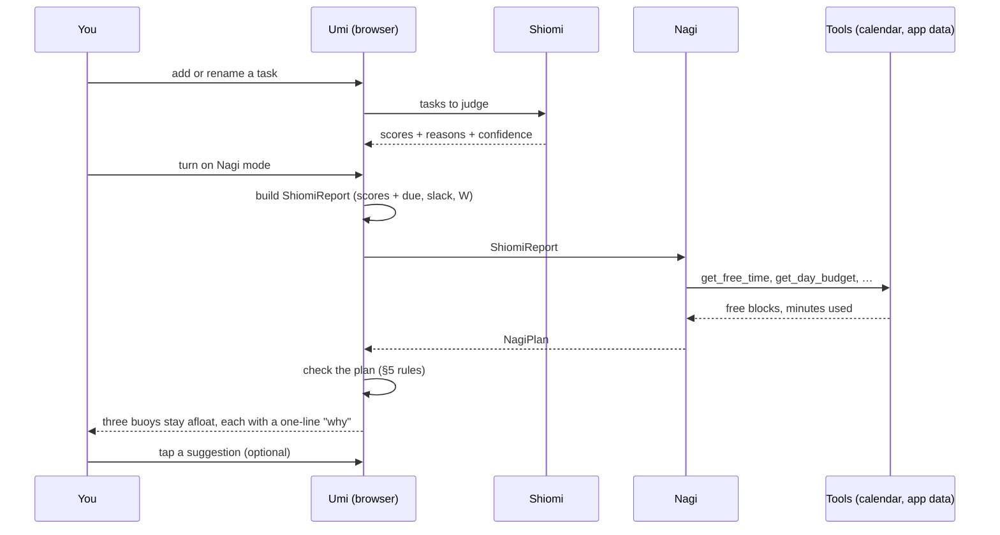

# Nagi agent — design

Status: built (2026-11-28). Phases 1 and 2 are live on Cloudflare Pages (moved from Vercel the same day); the calendar (phase 3) and A2UI cards (phase 4) are not built yet.

**Where it runs:** all on Cloudflare Pages Functions (https://umi-lake.pages.dev). Shiomi and Nagi are separate A2A agents (`functions/api/agents/shiomi.js`, `functions/api/agents/nagi.js`), each with an agent card (GET) and a JSON-RPC endpoint (POST `message/send` with data parts). `functions/api/nagi.js` resolves each card and hands the report from Shiomi to Nagi over A2A. Every call carries the user's Firebase ID token, checked by each agent. The same pair built on Google's ADK for Cloud Run is kept as a reference in `docs/reference/adk-agents/`.

## 1. Why

Today, Nagi mode is plain code: it sorts today's tasks by a formula (W) and keeps the top three.
Shiomi is a single model call that scores each task. Neither one plans.

The goal is two agents with clear jobs and a defined handoff:

- **Shiomi judges** each task on its own (what is it worth, what does missing it cost, how long does it take).
- **Nagi plans** the next few hours: given Shiomi's judgments, your calendar and the time you have, it picks the three to keep afloat and explains why.

Each agent stays small and testable, the handoff between them is an explicit contract, and Nagi still follows the app's rule of calm: it only **proposes**. It never changes tasks by itself.

## 2. What exists today

| Part | Where | What it does |
|---|---|---|
| Shiomi | `functions/api/weigh.js` (Pages Function) → Gemini 2.5 Flash-Lite | For up to 12 tasks: impact, penalty, effort, dependency (1–10), must (true/false), two short reasons |
| Must / own | `store.js` `values()` | What **you** set (typed "must"/"own", or chosen in the table) > Shiomi's `must` > fallback rule (penalty ≥ 6) |
| Order W | `store.js` `compute()` | `W = V / hours^0.6 × U(slack)`; urgency rises steeply as slack runs out |
| Nagi mode | `home.js` `calmSet()` | Top 3 of today's tasks by W; the rest sink out of view |

## 3. Roles

| | Shiomi (judge) | Nagi (planner) |
|---|---|---|
| Question it answers | "How heavy is this task?" | "Which three now, and why?" |
| Scope | One task at a time (batched), no memory of the day | Today as a whole |
| Runs when | A task is added or renamed | Nagi mode is turned on; the first open of the day; a kept task is sunk; the calendar changes |
| Inputs | Title, notes, area, has-a-due-date, your corrections as examples | **Shiomi's report** + due dates and slack + your calendar + hours per day + dive history |
| Tools | None | Read-only tools (§6) |
| Output | Scores and reasons per task | A plan: three to keep, suggestions for the rest, one short message |
| Writes to your data | Only its scores (`t.ai`) | Nothing. Suggestions need your tap |

## 4. The handoff: Shiomi → Nagi

The app does not pass Shiomi's raw answer along. It builds a **report**: Shiomi's judgment plus the numbers the app computes, so Nagi plans on facts and does not have to recompute them.

```jsonc
// ShiomiReport — one per planning run
{
  "version": 1,
  "generatedAt": "2026-11-28T09:12:00+01:00",
  "timezone": "Europe/Madrid",
  "lang": "en",                          // language for anything shown to the user
  "dayBudgetMin": 300,                   // hours you can use in a day (Settings)
  "tasks": [
    {
      "id": "yov3drgtozso",
      "title": "Hand in the presentation",
      "due": "2026-11-28", "time": null,  // due date and time, if any
      "estMin": 120,                      // your estimate, or Shiomi's effort mapped to minutes
      "slackDays": 0.6,                   // days until due − days of work (computed by the app)
      "order": 48.8,                      // W, the app's own ranking (Nagi may disagree, with a reason)
      "judgment": {
        "impact": 7, "penalty": 7, "effort": 4, "dependency": 1,
        "must": true,
        "source": "shiomi",               // "you" | "shiomi" | "rule": who decided each value
        "reason": "Needed for the course credit; the deadline is close.",
        "confidence": 0.8                 // new: how sure Shiomi is (0–1)
      }
    }
  ]
}
```

Notes:
- `source` matters: when **you** set a value, Nagi must treat it as fixed.
- `confidence` is new. Shiomi already returns a reason; asking for a confidence lets Nagi ask a clarifying question instead of guessing when a title is vague ("Prep" with no context).
- Only today's and this week's open tasks are sent. Nothing from the lakebed (finished tasks).

## 5. Nagi's output

```jsonc
// NagiPlan
{
  "version": 1,
  "keep": [                               // exactly up to three, in order
    { "id": "yov3drgtozso", "why": "Due tonight and you have a free block from 14:00." },
    { "id": "…", "why": "…" },
    { "id": "…", "why": "…" }
  ],
  "suggest": [                            // optional; each needs your tap
    { "id": "…", "action": "tomorrow", "why": "No free time left today after 18:00." },
    { "id": "…", "action": "lighter",  "why": "…" },
    { "id": "…", "action": "dive",     "minutes": 50, "why": "Fits your 14:00–15:00 gap." }
  ],
  "message": "A full afternoon. Start with the presentation.",   // one line, calm tone
  "validUntil": "2026-11-28T13:00:00+01:00"                      // re-plan after this
}
```

Rules the app enforces on the plan (it never trusts it blindly):
- Every `id` must exist and be open; otherwise the plan is dropped.
- `keep` must include every task **you** marked must that is overdue (a safety rule).
- `action` must be one of `tomorrow`, `lighter`, `later`, `dive`. Anything else is ignored.
- Texts are trimmed to a short length and shown as plain text.

## 6. Nagi's tools (read-only)

| Tool | Gives Nagi | Source |
|---|---|---|
| `get_free_time(date)` | Free blocks today, from your calendar | Google Calendar (read-only scope), through an MCP server or the Calendar API |
| `get_day_budget()` | Hours per day, minutes already used today | App data |
| `get_dive_history(days)` | When and how long you usually focus | App data (`t.dives`) |
| `get_task(id)` | Notes and history of one task, when the report is not enough | App data |

No tool can change anything. Changes happen only when you tap a suggestion, through the same code paths the buttons use today (`postpone`, `lighter`, `openDive`).

## 7. Flow



## 8. Protocols

| Layer | Choice | Why |
|---|---|---|
| Agent ↔ agent | **A2A** (Agent2Agent, JSON-RPC binding): each agent publishes an agent card; the report goes over in `message/send` as a data part; the reply message carries the plan as a data part | A standard, inspectable handoff instead of a hidden function call; either agent can be swapped or tested alone |
| Agent ↔ tools | **MCP** for the calendar; plain functions for app data | Calendar access is a separate, permissioned service; app data is already in the request |
| Agent framework | Live: Gemini function calling inside Cloudflare Pages Functions. Reference: **ADK** (Python) in `docs/reference/adk-agents/` | One project holds the app and both agents; ADK is the path if the agents move to Cloud Run |
| Agent → UI | Phase 2: **A2UI**-style declarative cards for Nagi's suggestions | The agent describes the card ("suggestion with Accept / Not now"); the app renders it with its own buttons and styles |

## 9. When things go wrong

| Situation | What happens |
|---|---|
| Nagi is slow (no answer in 25 s) or fails | Fall back to today's code: top 3 by W. A small "planned by formula" label shows |
| Shiomi has not judged a task yet | The report uses the rule estimate with `source: "rule"` and a low confidence |
| Calendar not connected | Nagi plans from hours per day only and says so in its message |
| The plan breaks a rule (§5) | Dropped; fall back to W |
| Offline / signed out | Nagi is off; Nagi mode works as today |

## 10. Cost and timing

- One Nagi run = one model call plus up to four tool calls. With Flash-Lite, roughly the same tiny cost as a Shiomi batch.
- Runs only on the triggers in §3, at most once every 10 minutes, and the plan is cached until `validUntil`.
- The same sign-in check and allow-list as `/api/weigh`.

## 11. Changes in the app

- Nagi mode: each kept buoy's tag gets the one-line "why" (hover, or the card).
- The Nagi message replaces the date line while Nagi mode is on.
- Suggestions appear as quiet buttons on the card: *Move to tomorrow* · *Not now*.
- The card's "Shiomi" line stays as it is; a "Nagi" line appears only for kept tasks.

## 12. How to judge it

- Log each plan next to the formula's top 3. Measure how often you accept suggestions, how often kept tasks get sunk that day, and how often you turn Nagi mode off soon after it plans.
- A small fixed test set (about 20 days of made-up tasks and calendars) run on every prompt change (ADK evaluation).

## 13. Phases

1. **Contract first** — done: `nagi.js` builds the ShiomiReport, checks every plan, and falls back to the formula.
2. **Nagi agent and the A2A handoff** — done, on Cloudflare Pages: `functions/api/agents/shiomi.js`, `functions/api/agents/nagi.js`, `functions/api/nagi.js`.
3. **Calendar** (read-only) behind a Settings switch — not yet; `get_free_time` says "not connected".
4. **Suggestions as A2UI cards**, and the evaluation set — not yet.

## 14. Decisions made

1. **Hosting**: Cloudflare Pages (first Vercel, moved on 2026-11-28 for a short URL). Cloud Run was prepared (ADK + A2A in Python, tested locally) but not needed; it stays as a reference.
2. **Calendar**: later (phase 3).
3. **A2A**: real A2A between two endpoints (each with its own agent card), even though both live in the same Pages project.
4. **Suggestions**: tomorrow, lighter, later, dive — each only runs when the user taps it.
